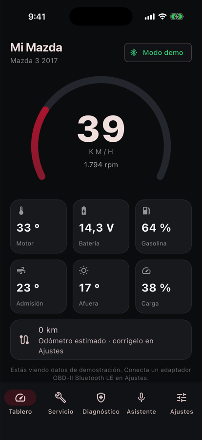
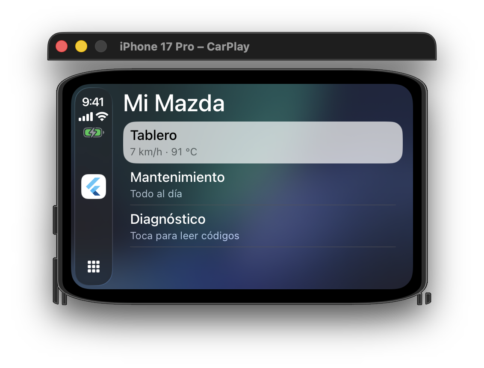

# mzd-owner · Mi Mazda

**Your Mazda on your phone — and on the car's screen.** Live data over OBD-II, maintenance
reminders, trouble codes explained by AI, a voice assistant, and CarPlay / Android Auto screens.
Open source (MIT), built with Flutter. Part of the [mzd-kit](https://github.com/jeronimotech/mzd-kit) family.

 

> **Status: v0.1, early.** Runs on iOS and Android. CarPlay works in the iOS Simulator (above);
> neither CarPlay nor Android Auto has been validated on a real car yet (see [CarPlay & Android Auto](#carplay--android-auto)).

## What it does

| | |
|---|---|
| **Tablero** | Speed, RPM, coolant, battery voltage, fuel, intake/ambient temperature, engine load — live from an OBD-II Bluetooth LE adapter. Estimated odometer (the 2017 Mazda doesn't expose it over OBD-II). |
| **Servicio** | Oil, tires, filters, brake fluid, plugs, coolant, SOAT, técnico-mecánica — due by km *or* months, whichever comes first. Editable intervals. |
| **Diagnóstico** | Reads stored trouble codes (check engine) and explains them with AI for your exact model. |
| **Asistente** | Ask by voice or text; answers are read aloud. Uses the [mzd-kit bridge](https://github.com/jeronimotech/mzd-kit/blob/main/docs/ASSISTANT.md) (Claude + web search), so questions and answers are shared with the car's native screen too. |
| **CarPlay / Android Auto** | Tablero, Servicio and Diagnóstico on the car's display using native templates. |
| **Widget + Live Activity** | "Estado de Mi Mazda" widget (battery, engine temperature, next service) and an "En ruta" Live Activity (speed, RPM, temperature, battery) on the lock screen, Dynamic Island and — on iOS 26 — the CarPlay dashboard, with no CarPlay entitlement needed. |

No adapter yet? **Demo mode** (on by default) simulates a city drive.

## Hardware

Any **ELM327-compatible Bluetooth LE** OBD-II adapter, plugged into the port under the steering wheel:

- ✅ Vgate iCar Pro BLE (4.0), Veepeak OBDCheck BLE+, OBDLink CX
- ❌ Bluetooth "Classic" adapters (most cheap ELM327 clones, OBDLink MX+) — iPhone can't use them

## Run it

```bash
flutter pub get
flutter run            # iPhone simulator, device, or Android
```

For the assistant, run the mzd-kit bridge on your network and set its URL in **Ajustes**:

```bash
cd mzd-kit && ANTHROPIC_API_KEY=… node bin/mzd.js dev examples --host 0.0.0.0
# app → Ajustes → URL del puente: http://<your-computer-ip>:5173/bridge
```

## CarPlay & Android Auto

Both platforms only allow **native templates** (lists, information panes), not custom UI, and
only for approved app categories.

**CarPlay** — category *driving task* (`com.apple.developer.carplay-driving-task`), refreshed every 10 s.
- Try it: run on the iOS Simulator, then **Simulator → I/O → External Displays → CarPlay**.
- On a real car: [request the entitlement from Apple](https://developer.apple.com/contact/carplay) (draft answers in [docs/CARPLAY_ENTITLEMENT.md](docs/CARPLAY_ENTITLEMENT.md)) and add it to the provisioning profile.
- Car screens can't draw custom UI, so the gauges are rendered on the phone as images and shown in iOS 26 list cards; icons are tinted by status (red overdue, amber soon, green OK).

**Android Auto** — Car App Library service, category `IOT` (closest fit; Google decides at review).
- Try it with the [Desktop Head Unit](https://developer.android.com/training/cars/testing/dhu).

Built on [flutter_carplay](https://pub.dev/packages/flutter_carplay) (MIT).

**Widgets & Live Activities on CarPlay (iOS 26)** — the richest look available without the
navigation category: they're SwiftUI (fully custom design), shown StandBy-style on the CarPlay
dashboard. Source: `ios/MiMazdaWidget/`, fed from Flutter through the `mzd/car_widgets` channel.
The widget appears on CarPlay's widget page; the drive Live Activity starts when the car connects.

## Architecture

```
lib/
  obd/            ELM327 protocol (pure Dart, tested), BLE adapter source, demo source
  models/         VehicleSnapshot, CarProfile, maintenance schedule + due logic
  state/          AppState (ChangeNotifier) — single source of truth for phone and car screens
  services/       mzd-kit bridge client (assistant), voice (speech-to-text, TTS)
  car/            CarPlay + Android Auto templates
  ui/             Phone screens
```

Bluetooth uses [universal_ble](https://pub.dev/packages/universal_ble) (BSD-3).

## Roadmap

- [ ] Validate CarPlay and Android Auto on a real car; request Apple's driving-task entitlement
- [ ] Trip log, fuel log and real consumption
- [ ] Mazda-specific PIDs (oil life, odometer where available)
- [ ] Push data to the car's native mzd-kit apps once the CMU is jailbroken
- [ ] Notifications for upcoming maintenance

## Disclaimer

Independent project, not affiliated with Mazda Motor Corporation. "Mazda" is a trademark of its
owner. Maintenance intervals are suggestions — follow your owner's manual. AI explanations of
trouble codes are informational; confirm with a mechanic. Don't interact with the phone while driving.

---

### 🇨🇴 En español

**Mi Mazda** es una app abierta para dueños de Mazda: datos en vivo por OBD-II, recordatorios de
mantenimiento (incluye SOAT y técnico-mecánica), códigos de falla explicados con IA, asistente por
voz y pantallas para CarPlay y Android Auto. Funciona en modo demo mientras consigues el adaptador.
